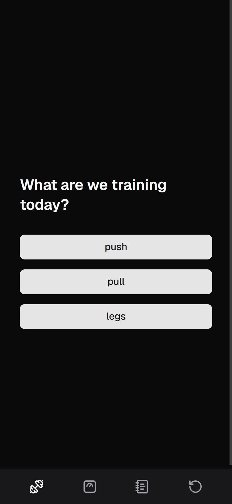
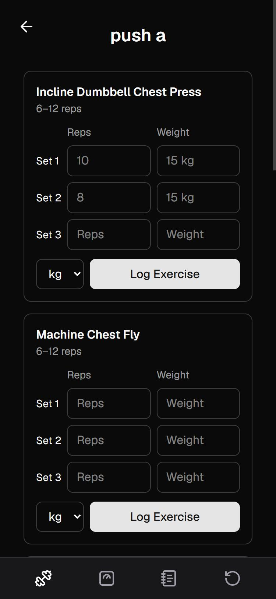
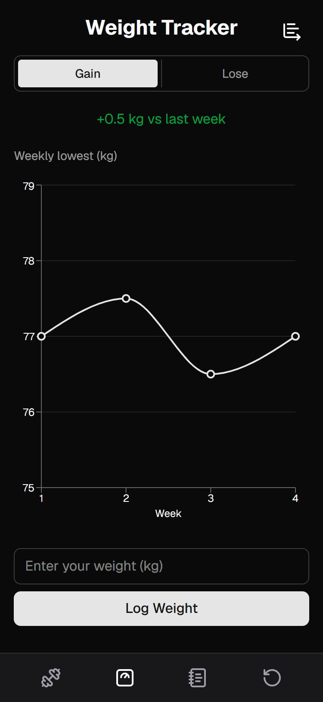
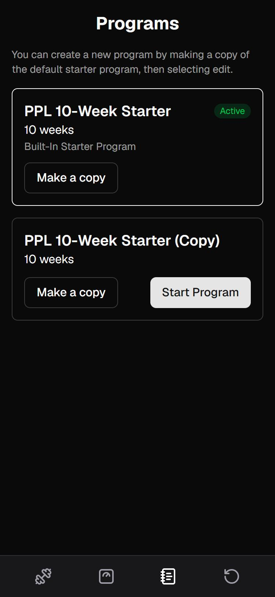

# Invenio

> This is a **showcase** repository: screenshots, features and design notes. The source code is in a private repository and is **available on request**.

A mobile-first web app for following a structured training program and tracking progress: logged lifts, bodyweight, and the program itself. Built with Next.js, TypeScript and PostgreSQL.

> **Status:** in active development. Core logging, bodyweight tracking and program management work today; editing programs, lift history and accounts are next. Final design pass still to be made. See the [roadmap](#roadmap).

  
  
  
  

## Why I'm building it

A few years ago I bought a 10-week program from a well-known coach. It arrived as a handful of notepad files and back-and-forth Messenger messages, with no way to log lifts or see progress. Tracking everything was up to me, along with keeping the coach updated through weekly check-ins. I ended up building a spreadsheet by hand, writing out every exercise against dates and week numbers, and editing cells to enter my lifts at the gym.

This app is what I wish had come with that program: the program itself, the logging and the progress in one place on my phone. The longer-term goal is for it to be a tool personal trainers can use to deliver programs to clients and overview their progress. Added features would include social group/friends interactivity, for gym-goers that are not on any paid coaching service that lift as a hobby to see how all their friends are tracking alongside them.

## Features

- **Workout logging:** pick a day (Push / Pull / Legs, A or B), log reps and weight for each set, in kg or lb.
- **Last session data:** each set's input shows what you lifted last time as a placeholder, so you always know what to aim for when progressively overloading.
- **Bodyweight tracking:** log a daily weigh-in: the chart plots your _lowest_ weight each week (Mon–Sun) to avoid daily water weight fluctuations.
- **Goal-aware feedback:** choose gain or lose, week-over-week change is coloured green or red accordingly.
- **Programs:** a built-in 10-week starter program; copy it to make your own, and switch between programs at any time.
- **Restarts that keep your history:** switching or restarting a program starts a new run from week 1. Previous runs and their logged sets are kept.

## Tech stack

| Area        | Tools                                                                                      |
| ----------- | ------------------------------------------------------------------------------------------ |
| Framework   | [Next.js 16](https://nextjs.org) (App Router, Server Components, Server Actions), React 19 |
| Language    | TypeScript                                                                                 |
| Styling     | Tailwind CSS v4                                                                            |
| Database    | PostgreSQL, hosted on [Supabase](https://supabase.com)                                     |
| Data access | [Drizzle ORM](https://orm.drizzle.team) and Drizzle Kit migrations                         |
| Charts      | Recharts                                                                                   |

## How it's built

A few decisions I made along the way:

- **Templates vs runs.** A _program_ is a reusable template (name, length, exercises per day). A _run_ is one dated attempt at a program. Logged sets belong to a run, so restarting or switching never touches past results.
- **The database protects logged data.** Foreign keys use `ON DELETE RESTRICT`, so Postgres refuses to delete an exercise or run that still has logged sets, even if application code tries to.
- **All or nothing copies.** Copying a program inserts the program and all its exercises inside a single transaction, so a failure part way can't leave a half copied program behind.
- **Swapping exercises doesn't rewrite history.** Exercises have an archived state, so when exercise swapping is implemented (next on the roadmap), old sets stay attached to the movement that was actually performed rather than being relabelled.
- **Reviewing generated migrations.** When I split programs into templates and runs, I read the generated SQL, found the steps that would fail against rows already in the database, and edited the migration before running it.
- **Server first.** Pages read from the database in Server Components, and forms write through Server Actions, so there's no separate API layer to maintain.

## Roadmap

- [x] Workout logging with previous-session placeholders
- [x] Bodyweight tracking with weekly-low chart and goal colouring
- [x] Programs: built-in starter, copy, switch, restart
- [ ] Edit programs: rename, set length, swap exercises, change rep ranges
- [ ] Lift history view: compare weeks side by side per exercise
- [ ] Accounts and authentication
- [ ] Share and import programs
- [ ] Trainer ↔ client linking, so coaches can follow client progress
- [ ] Friends and groups: see how your gym friends are tracking.

## How I'm building it

I'm a career-changer learning full-stack development. I write the code myself, using AI tools as a mentor for explanations and code review.

## Source code

The application code lives in a private repository. If you'd like to see it for job application purposes, please get in touch and I'm happy to walk through it or share access.

## License

© Brandon Viani. All rights reserved.
